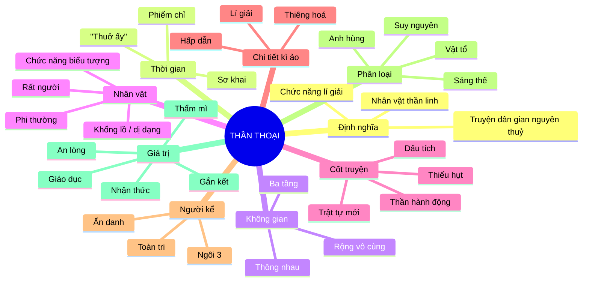
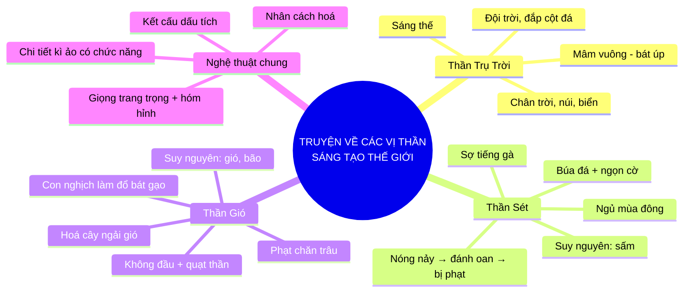
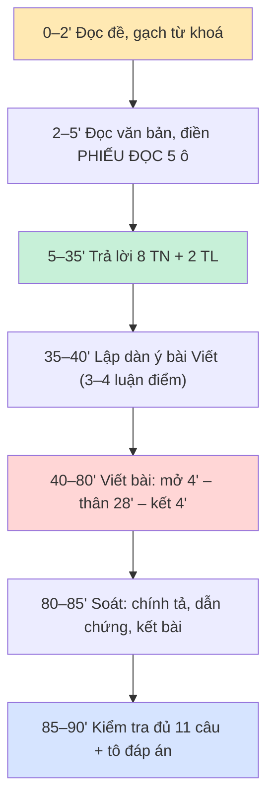

# PHẦN 7 — HỆ THỐNG GHI NHỚ: SƠ ĐỒ, BẢNG, FLASHCARD, MẸO NHỚ & KẾ HOẠCH

> Nguyên tắc: **não nhớ hình ảnh và cấu trúc nhanh hơn nhớ câu chữ.**
> Vì thế tệp này biến toàn bộ kiến thức thành **5 dạng**: sơ đồ – bảng – con số – câu chốt – flashcard.

---

## 1. BA SƠ ĐỒ TƯ DUY (Mermaid — dán vào bất kỳ trình xem Markdown nào có hỗ trợ Mermaid)

### 1.1. Sơ đồ 1 — Thể loại thần thoại (trục xương sống)



### 1.2. Sơ đồ 2 — Ba truyện trong SGK (nhánh "tam giác")



### 1.3. Sơ đồ 3 — Quy trình làm bài 90 phút (sơ đồ quyết định)



---

## 2. SÁU BẢNG "MỘT NHÌN LÀ NHỚ"

### 2.1. Bảng 1 — Năm câu hỏi của MỌI truyện thần thoại
| Câu hỏi | Trả lời cho Thần Trụ Trời |
|---|---|
| **Ai?** | Thần Trụ Trời khổng lồ |
| **Ở đâu?** | Vùng hỗn độn trời đất chưa tách |
| **Khi nào?** | Thuở sơ khai, "chưa có muôn vật và loài người" |
| **Làm gì?** | Đội trời, đắp cột đá, phá cột |
| **Để lại gì?** | Trời – đất – chân trời – núi – biển – gò đống |

> 🎯 Đây chính là **5 câu hỏi của đề thi**. Học 1 bảng = trả lời được câu 1, 2, 3, 4, 9.

### 2.2. Bảng 2 — Phân biệt 5 thể loại (bản nén)
| | Thần thoại | Truyền thuyết | Cổ tích | Sử thi | Truyền kì |
|---|---|---|---|---|---|
| Thời gian | sơ khai | lịch sử | "ngày xửa" | cổ đại | trung đại |
| Nhân vật | thần | anh hùng lịch sử | người nghèo | tù trưởng | người + ma |
| Lõi sự thật | niềm tin | lịch sử | không | lịch sử – xã hội | án oan, đạo lí |
| Chức năng | lí giải | ca ngợi | ước mơ | khẳng định cộng đồng | bài học đạo đức |

### 2.3. Bảng 3 — 13 yêu cầu đặc tả → 1 công thức
| Yêu cầu | Công thức |
|---|---|
| Thời gian | phiếm chỉ + sơ khai + dẫn cụm từ |
| Không gian | 3 tầng + thông nhau + dẫn chứng |
| Nhân vật | thần + phi thường + rất người + biểu tượng |
| Cốt truyện | thiếu hụt → hành động → trật tự → dấu tích |
| Chi tiết | nghĩa đen → biểu tượng → chức năng |
| Chủ đề | 1 câu + 2 căn cứ |
| Người kể | ngôi 3 + ẩn danh + toàn tri → 3 tác dụng |
| Bài học | nhận thức → hành động → liên hệ |
| Viết | giới thiệu → luận điểm → nghệ thuật → đánh giá |

### 2.4. Bảng 4 — Ba tầng nghĩa của 6 chi tiết "đinh"
| Chi tiết | Nghĩa đen | Biểu tượng | Chức năng |
|---|---|---|---|
| Mâm vuông – bát úp | Hình dạng trời đất | Tư duy nông nghiệp | Lí giải "chân trời" |
| Thần sợ tiếng gà | Bị gà mổ | Kẻ mạnh có điểm yếu | Lí giải sấm – gà gáy |
| Cây ngải cuốn lá | Cây báo mưa | Tri thức dân gian | Lí giải cây ngải, tục chữa bệnh |
| Quạ vàng ba chân | Mặt trời hoá chim | Tự nhiên có linh hồn | Lí giải + kì ảo hoá |
| Hạt lựu | Thức ăn âm phủ | Luật không thể phá | Lí giải bốn mùa |
| Nhất sinh đê thủ bái mai hoa | Cúi đầu trước hoa mai | Khí tiết | Tôn vinh cái đẹp |

### 2.5. Bảng 5 — Thang điểm & thời gian
| Phần | Điểm | Thời gian | Ưu tiên |
|---|---|---|---|
| 6 TN Biết | 3,0 | 10' | Lấy trọn (dễ nhất) |
| 2 TN Hiểu | 1,0 | 5' | Đọc kỹ đáp án |
| 1 TL Hiểu | 1,0 | 10' | Đủ 3 phần: tóm tắt + chủ đề + căn cứ |
| 1 TL Vận dụng | 1,0 | 12' | Đủ 3 tầng: nhận thức – hành động – liên hệ |
| 1 TL Viết | 4,0 | 45' | 3–4 luận điểm + đánh giá |

### 2.6. Bảng 6 — Từ Hán Việt: 4 tác dụng – 5 lỗi
| 4 tác dụng | 5 lỗi |
|---|---|
| Trang trọng | Sai nghĩa |
| Khái quát | Nhầm âm |
| Cổ kính | Lạm dụng |
| Nhịp điệu | Sai sắc thái |
| | Thừa nghĩa |

---

## 3. MƯỜI HAI CÂU CHỐT (đọc to trước khi ngủ — nhớ theo nhịp)

1. **Thần thoại = THẦN + THUỞ + LÍ GIẢI.**
2. Thời gian: **"thuở ấy"** — không năm, chỉ *trước*.
3. Không gian: **ba tầng, thông nhau, mở vô cùng**.
4. Nhân vật: **dị dạng hoặc khổng lồ + phi thường + rất người**.
5. Cốt truyện: **thiếu hụt → thần ra tay → trật tự → dấu tích**.
6. Kì ảo có **3 việc**: lí giải – thiêng hoá – hấp dẫn.
7. Người kể: **ngôi 3, ẩn danh, toàn tri ⇒ khách quan + niềm tin**.
8. Chủ đề: **1 câu + 2 căn cứ** (nhan đề/sự kiện + chi tiết/kết).
9. Bài học: **nhận thức → hành động → liên hệ**.
10. Viết: **giới thiệu → 3 luận điểm → nghệ thuật → đánh giá**.
11. Từ Hán Việt: **đúng nghĩa – đúng sắc thái – đúng liều lượng**.
12. Đề "ngoài SGK": **không học đề, học khuôn**.

### 3.1. Bốn câu lục bát chế (dễ thuộc hơn văn xuôi)
> *Thần thoại thuở ấy xa xưa,*
> *Thần là sấm, gió, nắng mưa trên trời.*
> *Cột đá chống giữa đất – trời,*
> *Dấu còn để lại cho đời nhớ ơn.*

> *Búa đá ai ném xuống đồng,*
> *Sấm rền một tiếng, gà lồng giật mình.*
> *Công lí chẳng chịu linh tinh,*
> *Đánh oan thì cũng phải mình chịu đau.*

> *Quạt thần ai quạt bay cao,*
> *Bát cơm đổ xuống, lệ trào người nghèo.*
> *Chăn trâu chuộc lỗi đã theo,*
> *Hoá cây ngải gió báo chiều mưa sang.*

> *Chủ đề một chữ cho nhanh:*
> *"Khát vọng, công lí" — hai nhành dựng xây.*
> *Dẫn chứng phải có kèm ngay,*
> *Nói không dẫn chứng, cầm tay hoà không!*

---

## 4. 50 FLASHCARD (che cột phải, tự trả lời, rồi mở ra)

| # | Câu hỏi | Đáp án |
|---|---|---|
| 1 | Định nghĩa thần thoại trong 1 câu | Truyện dân gian nguyên thuỷ kể về thần linh nhằm lí giải nguồn gốc thế giới, tự nhiên, loài người |
| 2 | Ba từ khoá của định nghĩa | siêu nhiên – sơ khai – lí giải |
| 3 | Thời gian thần thoại | Phiếm chỉ, sơ khai, "thuở ấy" |
| 4 | Không gian thần thoại | Ba tầng, thông nhau, rộng vô cùng |
| 5 | Ba đặc điểm ngoại hình nhân vật thần | Khổng lồ / dị dạng / phi thường |
| 6 | Bốn loại thần thoại | Sáng thế – suy nguyên – anh hùng – vật tổ |
| 7 | Ba chức năng của chi tiết kì ảo | Lí giải – thiêng hoá – hấp dẫn |
| 8 | Người kể chuyện thần thoại | Ngôi 3, ẩn danh, toàn tri |
| 9 | Ba tác dụng của cách kể ấy | Khách quan – quy mô vũ trụ – niềm tin tập thể |
| 10 | Công thức tóm tắt cốt truyện | Thiếu hụt → hành động → trật tự → dấu tích |
| 11 | Cách xác định chủ đề | 1 câu khái quát + 2 căn cứ (nhan đề/sự kiện; chi tiết/kết) |
| 12 | Khác biệt thần thoại – truyền thuyết | Sơ khai/thần linh ↔ lịch sử/nhân vật có thật |
| 13 | Truyện SGK gồm mấy truyện, tên gì | Ba: Thần Trụ Trời, Thần Sét, Thần Gió |
| 14 | Nguồn sưu tầm | Nguyễn Đổng Chi (NXB KHXH, 2003) |
| 15 | Việc làm của Thần Trụ Trời | Đội trời, đắp cột đá, phá cột |
| 16 | Chi tiết nổi tiếng của Thần Trụ Trời | "Đất phẳng như cái mâm vuông, trời như cái bát úp" |
| 17 | Thần Trụ Trời lí giải gì | Trời – đất, chân trời, núi, biển, gò đống |
| 18 | Vũ khí của Thần Sét | Búa đá + ngọn cờ |
| 19 | Vì sao Thần Sét sợ gà | Bị gà thần của Ngọc Hoàng mổ (do đánh oan) |
| 20 | Thần Sét lí giải gì | Sấm sét; mùa đông ít sấm; tục kiêng tiếng gà |
| 21 | Ngoại hình Thần Gió | Thân hình kỳ quặc, không có đầu |
| 22 | Bảo bối Thần Gió | Cây quạt nhiệm màu |
| 23 | Con thần Gió gây tội gì | Quạt làm đổ bát gạo của vợ chồng người nghèo |
| 24 | Hình phạt con thần Gió | Chăn trâu, rồi hoá cây ngải gió |
| 25 | Cây ngải gió báo gì | Trời sắp nổi gió, nổi mưa |
| 26 | Lá ngải dùng làm gì | Chữa bệnh cảm gió cho trâu |
| 27 | Giọng điệu ba truyện | Trang trọng + hóm hỉnh |
| 28 | Kết cấu đặc trưng | Kết cấu dấu tích |
| 29 | Tản Viên từ Phán sự lục – tác giả | Nguyễn Dữ (*Truyền kì mạn lục*) |
| 30 | Phẩm chất Ngô Tử Văn | Khảng khái, cương trực, dũng cảm |
| 31 | Tác dụng của kì ảo trong truyền kì | Mượn cõi âm nói cõi dương, phê phán kín đáo |
| 32 | Chữ người tử tù – tác giả | Nguyễn Tuân (*Vang bóng một thời*, 1940) |
| 33 | Ba nét của Huấn Cao | Tài – khí phách – thiên lương |
| 34 | Câu đối trong Chữ người tử tù | "Nhất sinh đê thủ bái mai hoa" |
| 35 | Ý nghĩa tư thế quản ngục quỳ | Đảo ngược quyền lực: cái đẹp đứng trên bạo lực |
| 36 | Tê-dê là ai | Anh hùng A-ten, con vua Ê-giê, diệt Mi-nô-tơ |
| 37 | Chi tiết biểu tượng trong Tê-dê | Cuộn chỉ của A-ri-an; cánh buồm trắng bị quên |
| 38 | Từ Hán Việt là gì | Từ vay tiếng Hán, đọc theo âm Hán Việt, đã Việt hoá |
| 39 | Ba lớp từ Hán Việt | Hán Việt cổ – Hán Việt – Hán–Nhật |
| 40 | Hai kiểu ghép Hán Việt | Chính–phụ (khu biệt) / đẳng lập (khái quát) |
| 41 | Bốn tác dụng của từ Hán Việt | Trang trọng – khái quát – cổ kính – nhịp điệu |
| 42 | Năm lỗi dùng từ Hán Việt | Sai nghĩa – nhầm âm – lạm dụng – sai sắc thái – thừa nghĩa |
| 43 | Ba cách giải nghĩa từ Hán Việt | Thay từ thuần Việt – tách yếu tố – đặt ngữ cảnh |
| 44 | Cấu trúc bài nghị luận truyện | Mở (3 thông tin) – Thân (3–4 luận điểm) – Kết (giá trị + dư âm) |
| 45 | Bốn luận điểm chuẩn | Chủ đề → Nhân vật/chi tiết → Nghệ thuật → Đánh giá |
| 46 | Ba bước phân tích dẫn chứng | Nêu – cắt nghĩa – đánh giá |
| 47 | Đoạn "ăn điểm Vận dụng" gồm gì | Giá trị + bài học + đồng tình/phản biện + liên hệ |
| 48 | Thang điểm bài Viết | 0,5 giới thiệu + 1,2 nội dung + 1,0 nghệ thuật + 0,8 đánh giá + 0,5 diễn đạt |
| 49 | Ba lỗi mất điểm nhất | Kể lại truyện – thiếu dẫn chứng – thiếu đánh giá |
| 50 | Câu thần chú cuối cùng | "Không học đề, học khuôn" |

---

## 5. KẾ HOẠCH ÔN 7 NGÀY (bản chi tiết có "cổng kiểm tra")

| Ngày | Buổi | Nội dung | Tệp | Cổng kiểm tra (phải đạt mới đi tiếp) |
|---|---|---|---|---|
| **1** | 60' | Giải mã ma trận; học định nghĩa + 5 đặc trưng | `00`, `01/01` §1–4 | Viết được 5 đặc trưng **không nhìn tài liệu** |
| **2** | 75' | 3 truyện SGK: bảng A2 + phân tích | `01/02` Phần A | Điền lại bảng A2 từ trí nhớ (6/9 dòng) |
| **3** | 60' | Tản Viên, Chữ người tử tù, Tê-dê | `01/02` Phần B–D | Nêu 3 nét của mỗi nhân vật chính |
| **4** | 75' | 10 dạng câu hỏi + làm 20 câu ngân hàng | `02/01`, `02/02` | Đúng ≥ 16/20 câu TN |
| **5** | 45' | Từ Hán Việt + lỗi dùng từ | `03` | Đúng ≥ 12/15 câu TN phần tiếng Việt |
| **6** | 90' | Dàn ý + viết 1 bài đủ 4,0 | `04/01`, `04/02` | Tự chấm theo rubric được ≥ 3,0 |
| **7** | 120' | Làm trọn đề 90' → chấm → xem flashcard | `05/01`, `05/02`, `06` | ≥ 7,5 điểm; thuộc 40/50 flashcard |

### 5.1. Nếu chỉ còn **3 ngày**
- **Ngày 1:** `06` (bảng + flashcard) → `02/01` (10 công thức).
- **Ngày 2:** `01/02` Phần A + F (dẫn chứng) → `04/01` (dàn ý).
- **Ngày 3:** làm đề `05/01` → **đọc kỹ đáp án** `05/02` (nhất là bài mẫu).

### 5.2. Nếu chỉ còn **1 ngày (3 giờ)**
| Thời lượng | Việc | Mục tiêu |
|---|---|---|
| 40' | Học 12 câu chốt + bảng 2.1, 2.3 | Nắm khung |
| 40' | Đọc `02/01` mục 2 (10 dạng) | Thuộc công thức |
| 40' | Đọc `04/01` mục 5 (dàn ý) + `04/02` bài mẫu 1 | Có khung viết |
| 60' | Đọc đề + **đáp án** `05/02` | Biết "gu" chấm |

---

## 6. CHECKLIST 24 GIỜ TRƯỚC KHI THI

**Kiến thức**
- [ ] Viết được định nghĩa thần thoại + 5 đặc trưng (TG–KG–NV–CT–KÌ).
- [ ] Kể được 3 truyện SGK, mỗi truyện: nhân vật – việc làm – điều lí giải.
- [ ] Nêu được 3 nét của Ngô Tử Văn, Huấn Cao, Tê-dê.
- [ ] Thuộc 2 câu chốt về chủ đề: "khát vọng chinh phục tự nhiên", "niềm tin vào công lí".
- [ ] Nhớ 6 chi tiết "đinh" (bảng 2.4).

**Kỹ năng**
- [ ] Thuộc 10 công thức trả lời (D1–D10).
- [ ] Thuộc dàn ý 4 luận điểm của bài Viết.
- [ ] Có sẵn 5 câu dẫn "vạn năng" trong đầu.

**Tâm lý & vật chất**
- [ ] Ngủ đủ 7–8 giờ (không học xuyên đêm — nhớ giảm 30%).
- [ ] Chuẩn bị: bút mực 2 chiếc, bút chì, tẩy, thước, giấy nháp, nước uống.
- [ ] Đến sớm 15 phút; đọc đề 2 lần trước khi viết.

**Trong phòng thi**
- [ ] Ghi ngay ra nháp: **"35' đọc hiểu – 5' dàn ý – 45' viết – 5' soát"**.
- [ ] Làm câu dễ trước (6 TN Biết) — tạo đà tâm lý.
- [ ] Không bỏ trống câu nào.
- [ ] Trước khi nộp: kiểm tra **đủ 11 câu**, **đủ 3 phần** bài viết, **không sai tên riêng**.

---

## 7. BẢNG TỰ ĐÁNH GIÁ THEO "VÙNG AN TOÀN"

| Vùng | Bạn đang ở đâu? | Việc cần làm |
|---|---|---|
| 🟢 **An toàn** | Thuộc 5 đặc trưng + 10 công thức + dàn ý | Luyện đề 2, 3 để giữ "phản xạ" |
| 🟡 **Cận an toàn** | Thuộc đặc trưng nhưng lúng túng khi viết | Viết 1 bài/ngày trong 3 ngày, tự chấm rubric |
| 🟠 **Rủi ro** | Nhớ truyện nhưng không nhớ đặc trưng thể loại | Học lại `01/01`, làm 40 câu `02/02` |
| 🔴 **Nguy hiểm** | Chưa biết đề thi gồm những gì | Đọc `00` + `06` ngay, bám 12 câu chốt |

---

## 8. MỘT TRANG CUỐI — "TẤM KHIÊN" TRƯỚC KHI VÀO PHÒNG THI

```
┌─────────────────────────────────────────────────────────────┐
│  ĐỀ: 11 câu / 10 điểm / 90 phút                             │
│  Đọc hiểu 6,0  (8 TN + 2 TL)   |   Viết 4,0  (1 TL)        │
├─────────────────────────────────────────────────────────────┤
│  THẦN THOẠI = THẦN + THUỞ + LÍ GIẢI                        │
│  TG: phiếm chỉ   KG: 3 tầng   NV: thần, rất người           │
│  CT: thiếu hụt → hành động → trật tự → DẤU TÍCH             │
│  CHI TIẾT: nghĩa đen → biểu tượng → chức năng               │
│  CHỦ ĐỀ: 1 câu + 2 CĂN CỨ                                   │
│  BÀI HỌC: nhận thức → hành động → liên hệ                   │
├─────────────────────────────────────────────────────────────┤
│  VIẾT: MB 3 thông tin → 4 LĐ (chủ đề / nhân vật+chi tiết /  │
│        nghệ thuật / đánh giá) → KB có hình ảnh              │
├─────────────────────────────────────────────────────────────┤
│  3 ĐIỀU KHÔNG ĐƯỢC QUÊN:                                     │
│  ① Mỗi nhận định PHẢI có dẫn chứng trong văn bản            │
│  ② Phải có phần NGHỆ THUẬT và phần ĐÁNH GIÁ                 │
│  ③ Không bao giờ kể lại truyện thay vì phân tích            │
└─────────────────────────────────────────────────────────────┘
```

---

## ✅ KẾT

Bạn vừa đi qua toàn bộ vùng kiến thức của đề giữa kì I: **từ ma trận → thể loại → văn bản → kỹ năng đọc →
tiếng Việt → kỹ năng viết → đề + đáp án → hệ thống ghi nhớ**.

Điều duy nhất còn lại là **làm** — hãy mở `05-de-thi/01-de-giua-ki-1.md`, bấm 90 phút, và tự chấm.
Đó là lần "thi thử" có giá trị bằng **10 lần đọc tài liệu**.

*Chúc bạn làm bài thật tốt. Thần thoại là câu chuyện về những người dám đặt câu hỏi — hôm nay, bạn cũng vậy.*
