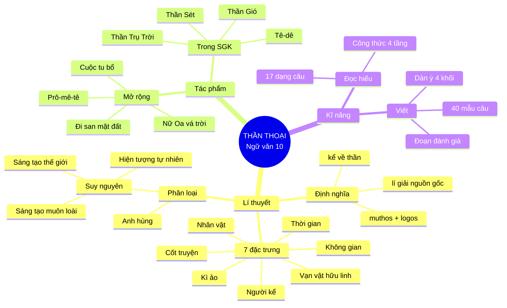
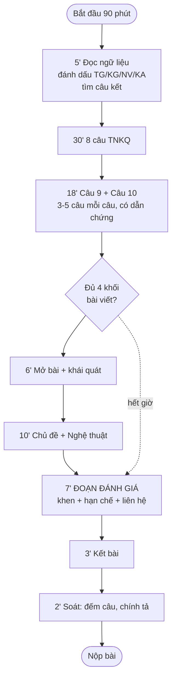

# 07 · BỘ CÔNG CỤ GHI NHỚ

> **Nguyên lí:** trí nhớ không phải cái xô để đổ đầy, mà là **con đường mòn** — đi nhiều thì thành lối.
> Chuyên đề này cung cấp **5 công cụ** để "đi lại" kiến thức: bảng nén → flashcard → sơ đồ tư duy → mnemonic → lịch lặp lại ngắt quãng.

---

## 🚑 PHẦN 0 — TRANG BỊ TỐI THIỂU (dành cho 3 giờ cuối)

> Nếu bạn chỉ còn 3 giờ, **chỉ học đúng trang này**. Đây là 90% khả năng trúng đề.

```
① THỂ LOẠI (1 câu)
   Thần thoại = truyện kể về THẦN, có CHI TIẾT KÌ ẢO, kết thúc bằng "TỪ ĐÓ…" để LÍ GIẢI nguồn gốc.

② 7 ĐẶC TRƯNG — "KHÔNG – THỜI – CỐT – NHÂN – KỂ – ẢO – LINH"
   Không gian vũ trụ đa cõi · Thời gian phiếm chỉ nguyên thuỷ · Cốt truyện đơn tuyến
   kết bằng suy nguyên · Nhân vật thần, chức năng, kì vĩ · Người kể ngôi 3 toàn tri giấu mình
   · Kì ảo (phóng đại/siêu năng/biến hoá) · Vạn vật hữu linh

③ 3 VỊ THẦN — "CỘT – BÚA – QUẠT"
   Trụ Trời = CỘT (đắp cột, tách trời đất) · Sét = BÚA (búa đá, sợ gà, công lí)
   · Gió = QUẠT (không đầu, quạt thần, cây ngải)

④ 1 TÁC PHẨM HY LẠP — TÊ-DÊ
   Edith Hamilton · con vua Ê-giê · đi bộ tới A-ten · diệt Mi-nô-tơ nhờ cuộn chỉ A-ri-an
   · quên cương buồm trắng → biển Ê-giê · làm vua, từ bỏ vương quyền, lập chính quyền nhân dân.

⑤ BÀI VIẾT — 4 KHỐI
   Mở (tên + thể loại + vấn đề) → Chủ đề (2 đoạn) → Nghệ thuật (3 đoạn, CÓ TÁC DỤNG)
   → ĐÁNH GIÁ (1 đoạn riêng: khen + hạn chế + liên hệ) → Kết.

⑥ 3 CÂU "VẠN NĂNG"
   • "Chi tiết ấy mang chức năng NHẬN THỨC: nó phải 'gánh' hiện tượng…"
   • "Câu kết 'Từ đó…' chuyển từ huyền thoại sang hiện tại, khiến lời giải thích có sức thuyết phục."
   • "Điều khiến tôi tâm đắc nhất là… Tuy vậy, tôi cũng thấy một giới hạn…"
```

---

## 📄 PHẦN 1 — BẢNG NÉN TOÀN BỘ (1 trang A4)

### 1.1. Bảng nén thể loại

| Hạng mục | Nội dung nén |
|---|---|
| Định nghĩa | Tự sự dân gian kể về **thần**, lí giải **nguồn gốc** vũ trụ – loài người – hiện tượng; thể hiện **nhận thức + khát vọng** của người cổ |
| Từ nguyên | *muthos* (lời kể) + *logos* (lí lẽ) |
| 7 đặc trưng | Không – Thời – Cốt – Nhân – Kể – Ảo – Linh |
| Phân loại | **Suy nguyên** (sáng tạo thế giới / muôn loài / hiện tượng) + **Anh hùng** |
| Kì ảo | Phóng đại · Siêu năng · Biến hoá/vật thiêng |
| Khác cổ tích | Thần thoại kì ảo để **HIỂU**; cổ tích kì ảo để **MONG** |
| Khác truyền thuyết | Thần thoại: **thế giới**; truyền thuyết: **lịch sử**; cổ tích: **công lí** |
| Nét riêng VN | **Thần cũng lao động** (đào, đắp, san) |

### 1.2. Bảng nén 8 văn bản

| Truyện | Nền | Loại | Chi tiết "chốt" | Giải thích | Một chữ khoá |
|---|---|---|---|---|---|
| Thần Trụ Trời | Việt | Sáng tạo TG | đội trời, đắp cột, ném đá | chân trời, núi, biển | **CỘT** |
| Thần Sét | Việt | Suy nguyên | búa đá, sợ tiếng gà | sấm sét, mùa đông | **BÚA** |
| Thần Gió | Việt | Suy nguyên | không đầu, quạt thần | gió, lốc, ngải gió | **QUẠT** |
| Tê-dê | Hy Lạp | Anh hùng | cuộn chỉ, buồm trắng | biển Ê-giê | **CHỈ** |
| Prô-mê-tê | Hy Lạp | Sáng tạo + AH | trộm lửa, gan mọc lại | người có lửa | **LỬA** |
| Đi san mặt đất | Lô Lô | Sáng tạo TG | "nhiều tay chung một ý" | đất bằng phẳng | **SAN** |
| Cuộc tu bổ… | Việt | Sáng tạo muôn loài | chân ghế, chân hương | chó/vịt co chân, chim chới 3 lần | **CHÂN** |
| Nữ Oa vá trời | Trung Quốc | Sáng tạo + cứu thế | đá ngũ sắc, chân rùa | trời nghiêng, sông chảy | **VÁ** |

> 🧠 **Chuỗi 8 chữ khoá:** **CỘT – BÚA – QUẠT – CHỈ – LỬA – SAN – CHÂN – VÁ**
> Đọc thành câu: *"Cột búa quạt chỉ, lửa san chân vá."*

### 1.3. Bảng nén cách làm bài

| Phần | Thời gian | Việc phải làm | Câu chốt |
|---|---|---|---|
| Đọc ngữ liệu | 5' | Đánh dấu TG/KG/NV/KA + tìm câu kết | "Từ đó…" |
| 8 TNKQ | 30' | Mỗi câu 4' | chọn xong **không sửa** trừ khi chắc chắn |
| 2 TL đọc hiểu | 18' | 3–5 câu/câu, có dẫn chứng | "cho thấy…", "vì thế…" |
| 1 TL viết | 33' | 4 khối, **chừa 7' cho đánh giá** | "Điều khiến tôi tâm đắc…" |
| Soát | 2' | đếm câu, chính tả | |

---

## 🃏 PHẦN 2 — 120 FLASHCARD (che cột phải mà tự kiểm)

> **Cách dùng:** đọc cột trái → tự trả lời **thành tiếng** → mở cột phải. Sai thì đánh dấu ▲.
> Mỗi lần ôn chỉ học các thẻ **▲ + 10 thẻ mới**.

### BỘ 1 — LÍ THUYẾT THỂ LOẠI (20 thẻ)

| # | Hỏi | Đáp |
|---|---|---|
| 1 | Thần thoại là gì? | Thể loại tự sự dân gian kể về thần, lí giải nguồn gốc vũ trụ – loài người – hiện tượng tự nhiên |
| 2 | *Muthos* nghĩa là gì? | Lời kể, câu chuyện (đối lập *logos* = lí lẽ) |
| 3 | Thần thoại ra đời sớm hay muộn trong tự sự dân gian? | **Sớm nhất** — trước truyền thuyết, cổ tích |
| 4 | 7 đặc trưng? | Không – Thời – Cốt – Nhân – Kể – Ảo – Linh |
| 5 | Mấy kiểu không gian thần thoại? | 3: sơ khai/hỗn độn · vũ trụ phân lập · thiên đình–hạ giới |
| 6 | Thời gian thần thoại có tính gì? | **Phiếm chỉ, nguyên thuỷ**, không xác định |
| 7 | Cụm từ đánh dấu thời gian thần thoại? | "Thuở ấy", "ngày xưa", "khi chưa có…" |
| 8 | Cụm từ nối huyền thoại với hiện tại? | "Từ đó…", "Vì thế mà bây giờ…", "Cho nên…" |
| 9 | Cốt truyện thần thoại có mấy nhịp? | 4: bối cảnh sơ khai → hành động → biến cố → kết quả + suy nguyên |
| 10 | Cốt truyện thần thoại có đặc điểm gì? | **Đơn tuyến**, xoay quanh **một hành động trung tâm** |
| 11 | Nhân vật thần thoại có mấy tầng? | 4: thần sáng tạo · thần chức năng · thần quyền lực · anh hùng văn hoá |
| 12 | Nhân vật thần thoại thiếu gì so với nhân vật cổ tích? | **Đời sống nội tâm phức tạp** — họ thuần **chức năng** |
| 13 | Người kể chuyện thần thoại ở ngôi nào? | Ngôi **3**, toàn tri, giấu mình |
| 14 | 3 tác dụng của ngôi kể thần thoại? | Khách quan · tiếng nói tập thể · thiêng hoá |
| 15 | 3 thủ pháp tạo kì ảo? | Phóng đại · siêu năng · biến hoá/vật thiêng |
| 16 | Kì ảo thần thoại khác cổ tích ở đâu? | Thần thoại: để **HIỂU** (nhận thức) · Cổ tích: để **MONG** (ước mơ) |
| 17 | Vạn vật hữu linh là gì? | Mọi vật đều có linh hồn / do thần cai quản |
| 18 | Thần thoại suy nguyên chia mấy nhóm? | 3: sáng tạo thế giới · sáng tạo muôn loài · suy nguyên hiện tượng |
| 19 | Mục đích 3 thể loại (thần thoại – truyền thuyết – cổ tích)? | Thế giới – Lịch sử – Công lí |
| 20 | Nét riêng của thần thoại Việt Nam? | **Thần cũng lao động**: đào đất, đắp cột, san đất — không chỉ dùng phép |

### BỘ 2 — THẦN TRỤ TRỜI & THẦN SÉT (20 thẻ)

| # | Hỏi | Đáp |
|---|---|---|
| 21 | Ai sưu tầm *Truyện về các vị thần sáng tạo thế giới*? | **Nguyễn Đổng Chi**, *Lược khảo về thần thoại Việt Nam* |
| 22 | Văn bản gồm mấy truyện? | 3: Thần Trụ Trời, Thần Sét, Thần Gió |
| 23 | Mở đầu Thần Trụ Trời? | "Thuở ấy, chưa có vũ trụ, chưa có muôn vật và loài người" |
| 24 | Thần Trụ Trời làm gì? | Đầu đội trời, đào đất đá **đắp cột** chống trời |
| 25 | Khi trời cao vừa ý, thần làm gì? | **Phá cột**, ném đá và đất ra khắp nơi |
| 26 | Đá và đất ném ra thành gì? | Đá → núi, đảo; đất → đồi, cao nguyên; chỗ đào lên → biển |
| 27 | Câu so sánh nổi tiếng? | "Đất phẳng như cái mâm vuông, trời ở trên như cái bát úp" |
| 28 | "Chân trời" là gì? | Chỗ giáp giới giữa trời và đất (theo truyện) |
| 29 | Sau thần Trụ Trời còn có ai? | Các thần khác được **phân công**: đào sông, tát biển, trồng cây, kể sao, đếm cát |
| 30 | Vì sao nói Thần Trụ Trời thể hiện văn minh nông nghiệp? | Thần tạo thế giới bằng **lao động** (đào, đắp, ném), không bằng phép màu |
| 31 | Tên hiệu khác của thần Sét? | **Thiên Lôi**, **ông Sấm** |
| 32 | Ngoại hình thần Sét? | Mặt mũi nanh ác, mình đen thui, vận **khố**, lưng đeo **trống**, tay cầm **búa đá** |
| 33 | Chức năng thần Sét? | **Thi hành luật pháp** ở trần gian theo lệnh Ngọc Hoàng |
| 34 | Cách thần Sét xử án? | Trỏ **ngọn cờ** vào đầu tội nhân rồi **bổ búa** lên đầu (không chém vào cổ) |
| 35 | Chi tiết "quẳng búa lại" giải thích gì? | Những hòn đá hình lưỡi búa dân gian nhặt được ("búa thần", đá sét) |
| 36 | Thần Sét ngủ khi nào? | Suốt **mùa đông**, khoảng tháng Hai – Ba âm lịch mới dậy |
| 37 | Vì sao mùa đông ít sấm? | Vì thần Sét **ngủ đông** |
| 38 | Vì sao thần Sét bị phạt? | **Đánh oan** người và vật vô tội (tính nóng nảy) |
| 39 | Hình phạt thần Sét phải chịu? | Bị bắt **nằm im** một chỗ, **gà thần** thỉnh thoảng mổ vào đầu |
| 40 | Từ đó sinh ra tục gì? | Thấy **chớp** thì bắt chước **tiếng gọi gà** để "doạ" thần Sét |

### BỘ 3 — THẦN GIÓ & TÊ-DÊ (20 thẻ)

| # | Hỏi | Đáp |
|---|---|---|
| 41 | Hình dạng thần Gió? | Kì quặc, **không có đầu** |
| 42 | Bảo bối của thần Gió? | Một chiếc **quạt nhiệm màu** |
| 43 | Thần Gió làm việc theo lệnh ai? | **Ngọc Hoàng** (gió nhỏ/bão lớn, lâu/mau) |
| 44 | Thần Gió phối hợp với ai? | Thần **Mưa**, có khi cả thần **Sét** → bão giông đáng sợ nhất |
| 45 | Gió xoáy buổi tối giữa đồng bằng gọi là gì? | **Thần Cụt Đầu** |
| 46 | Con thần Gió gây ra chuyện gì? | Nghịch quạt → **bát gạo** của người nghèo văng xuống ao |
| 47 | Người mất gạo đang làm gì? | Vo gạo để nấu cháo cho **vợ ốm** (đi xa hơn một ngày đường xin gạo) |
| 48 | Người đó phản ứng thế nào? | Khóc lóc, căm tức, **kiện lên thiên đình** |
| 49 | Hình phạt cho con thần Gió? | Đày xuống trần **chăn trâu** cho người mất gạo |
| 50 | Sau đó còn bị hoá thành gì? | **Cây ngải gió** (ngải tướng quân) để **báo tin gió** |
| 51 | Dấu hiệu nhận biết sắp mưa? | Cây ngải gió **cuốn bông, cuốn lá** lại |
| 52 | Vì sao lá ngải chữa cảm gió cho trâu? | Vì con thần Gió từng **chăn trâu** nên "có kinh nghiệm" |
| 53 | 4 lí do tạo nhân vật đứa con thần Gió? | Lí giải cây ngải · nhân cách hoá gió lốc · bài học công lí · chất hài |
| 54 | Tác giả *Tê-dê*? | **Ê-đi Ha-min-tơn** (Edith Hamilton), *Thần thoại* (1942) |
| 55 | Tê-dê là con của ai? | Vua **Ê-giê** nước A-ten |
| 56 | Vật gửi dưới tảng đá? | Một thanh **kiếm** và một đôi **giày** |
| 57 | Vì sao Tê-dê không đi thuyền? | Cho đó là **lối của kẻ hèn**, muốn lẩn tránh nguy hiểm |
| 58 | Tê-dê giết quái vật gì, nhờ đâu? | **Mi-nô-tơ**, nhờ **cuộn chỉ** của công chúa **A-ri-an** |
| 59 | Vì sao có tên biển Ê-giê? | Tê-dê **quên căng buồm trắng** → vua cha tưởng con chết, gieo mình xuống biển |
| 60 | Tê-dê làm gì khi lên ngôi? | **Từ bỏ vương quyền tuyệt đối**, lập chính quyền **nhân dân bình đẳng**, chỉ giữ chức Tổng chỉ huy quân đội |

### BỘ 4 — MỞ RỘNG & SO SÁNH (20 thẻ)

| # | Hỏi | Đáp |
|---|---|---|
| 61 | Prô-mê-tê nặn người bằng gì? | **Đất và nước** |
| 62 | Ê-pi-mê-tê mắc lỗi gì? | Ban hết phẩm chất cho **thú vật** → loài người trần trụi, yếu ớt |
| 63 | Prô-mê-tê ban gì cho loài người? | **Dáng đứng thẳng** + **lửa** + các kĩ thuật, nghề nghiệp |
| 64 | Hình phạt của Prô-mê-tê? | Bị **xích vào núi Cáp-ca-dơ**, đại bàng ăn **lá gan** (gan mọc lại) |
| 65 | *Đi san mặt đất* của dân tộc nào? | Người **Lô Lô** |
| 66 | Câu thơ tiêu biểu của *Đi san mặt đất*? | "Nhiều sức chung một lòng / San mặt đất cho phẳng" |
| 67 | Điểm đặc biệt của *Đi san mặt đất*? | **Không có thần** can thiệp — con người **tự** san đất |
| 68 | Người Lô Lô chọn trâu thế nào? | Trâu **sừng cong, sừng dài** (= trâu khoẻ) để cày bừa san đất |
| 69 | *Cuộc tu bổ lại các giống vật* do ai sưu tầm? | **Nguyễn Đổng Chi** |
| 70 | Ai mở "cuộc tu bổ" và sai ai? | **Ngọc Hoàng** sai **ba vị Thiên thần** mang nguyên liệu xuống núi |
| 71 | Vì sao phải tu bổ? | Ngọc Hoàng nặn muôn loài **vội vã, thiếu nguyên liệu** → nhiều con **khiếm khuyết** |
| 72 | Chó và vịt được chắp chân bằng gì? | **Chân ghế** (vì đến muộn, hết nguyên liệu) |
| 73 | Vì sao chó, vịt co một chân khi ngủ? | Thiên thần **dặn** chớ để cẳng xuống đất |
| 74 | Chim nhỏ (chiền chiện, đỏ nách, ốc cau) được chắp chân bằng gì? | Một nắm **chân hương** |
| 75 | Vì sao chim **chới với ba lần** trước khi đậu? | Lời dặn của Thiên thần: thử chân cho vững rồi hãy đậu |
| 76 | Nữ Oa là thần thế nào? | **Đầu người mình rắn**, nữ thần trong thần thoại Trung Quốc |
| 77 | Nữ Oa nặn người bằng gì? | **Đất bùn** (nặn tay; sau dùng dây nhúng bùn vung lên) |
| 78 | Vì sao trời nghiêng, sông chảy về đông nam? | **Cộng Công** húc đổ núi **Bất Chu** làm gãy cột chống trời |
| 79 | Nữ Oa vá trời bằng gì? | **Đá ngũ sắc** luyện thành; chặt **chân rùa** làm cột chống |
| 80 | Khác nhau cốt lõi VN – Hy Lạp – Trung Quốc? | VN: thần **lao động** · Hy Lạp: thần **ban tặng/hi sinh** · TQ: thần **tu bổ** |

### BỘ 5 — KĨ NĂNG ĐỌC HIỂU (20 thẻ)

| # | Hỏi | Đáp |
|---|---|---|
| 81 | Câu hỏi "thể loại" — 3 dấu hiệu? | Nhân vật thần · chi tiết kì ảo · kết thúc suy nguyên |
| 82 | Câu "xác định thời gian/không gian" — mấy tầng? | **2**: trích dẫn cụm từ → gọi tên tính chất |
| 83 | Câu hỏi "sự kiện trung tâm" — tìm thế nào? | Sự kiện mà **bỏ nó, câu kết vô nghĩa** |
| 84 | 3 thủ pháp kì ảo nhận diện bằng gì? | Phóng đại (kích thước) · siêu năng (việc người không làm được) · biến hoá/vật thiêng |
| 85 | 4 đề tài thần thoại? | Sáng tạo thế giới · sáng tạo muôn loài · suy nguyên hiện tượng · anh hùng |
| 86 | 3 lớp bối cảnh? | Kinh tế–sinh thái · tín ngưỡng · xã hội |
| 87 | Công thức tóm tắt cốt truyện? | 4 câu: bối cảnh → hành động → biến cố → suy nguyên |
| 88 | Công thức phân tích nhân vật? | 4 tầng: **vị trí → hành động → tính cách → ý nghĩa** |
| 89 | Câu hỏi chủ đề cần thêm gì ngoài chủ đề? | **Căn cứ**: nhan đề/đề tài · chi tiết tiêu biểu · câu kết/giọng điệu |
| 90 | Chủ đề khác tư tưởng thế nào? | Chủ đề = truyện nói về **cái gì**; tư tưởng = **khẳng định điều gì** |
| 91 | Tác dụng người kể chuyện — "3 + 1"? | Khách quan · tập thể · bao quát + **thiêng hoá** |
| 92 | Công thức "chi tiết kì ảo" 4 bậc? | Nghĩa đen → suy nguyên → nhận thức → thẩm mĩ |
| 93 | Cách xử lí câu "nhan đề"? | 3 câu: nghĩa đen → bao quát → biểu tượng |
| 94 | Công thức rút bài học? | Văn bản → đời sống → **giới hạn** |
| 95 | Công thức "tác động tới bản thân"? | **Trước → Sau → Tình cảm** |
| 96 | Công thức vận dụng bối cảnh? | Bối cảnh → **dấu vết** → thông điệp |
| 97 | Công thức đánh giá "3C"? | **C**a ngợi · **C**hê/giới hạn · **C**ần (nên giữ gì) |
| 98 | Đoạn văn 150 chữ — mấy câu? | 5: mở · nêu · lí giải · mở rộng · kết (**không xuống dòng**) |
| 99 | Số ý ≈ mấy lần điểm? | **Điểm × 2** (câu 1,0 đ → 2–3 ý) |
| 100 | Câu 1,0 điểm nên dài bao nhiêu? | **4–6 câu** (câu vận dụng 5–8 câu) |

### BỘ 6 — KĨ NĂNG VIẾT & CHIẾN LƯỢC (20 thẻ)

| # | Hỏi | Đáp |
|---|---|---|
| 101 | 3 từ khoá quyết định điểm bài viết? | **Phân tích** · **đánh giá** · **chủ đề + nghệ thuật** |
| 102 | Mở bài phải có 3 gì? | **Tên tác phẩm + thể loại + vấn đề** nghị luận |
| 103 | Thân bài có mấy khối? | 4: khái quát · chủ đề · nghệ thuật · **đánh giá** |
| 104 | Bao nhiêu điểm thuộc mức Vận dụng trong bài viết? | **2,0/4,0** |
| 105 | Nếu không có đoạn đánh giá thì tối đa mấy điểm? | **3,0** |
| 106 | Mỗi nét nghệ thuật phải kèm gì? | **Tác dụng** (thẩm mĩ / nhận thức / biểu đạt) |
| 107 | Thang 4 bậc phân tích chi tiết? | Kể → giải thích → nhận thức → **đánh giá** |
| 108 | Nên chọn mấy nét nghệ thuật? | **3** (mỗi nét 1 đoạn) |
| 109 | Thời gian viết bài? | **33 phút**; chừa **7 phút** cho đoạn đánh giá |
| 110 | Phút 29 chưa xong khối 3 thì làm gì? | **Cắt bớt, viết ngay khối đánh giá** |
| 111 | Bài viết nên dài bao nhiêu? | **500–700 chữ** (khoảng 1,5–2 trang) |
| 112 | Kết bài có được lặp mở bài? | **Không** — khẳng định lại bằng cách khác |
| 113 | Tổng thời gian đọc hiểu tối đa? | **48 phút** (5' đọc + 30' TN + 18' TL) |
| 114 | Số câu / số điểm / thời gian? | **11 câu · 10 điểm · 90 phút** |
| 115 | Tỉ lệ Đọc hiểu : Viết? | **60% : 40%** (6,0 : 4,0) |
| 116 | Tỉ lệ 3 mức độ? | **40% Biết · 30% Hiểu · 30% Vận dụng** |
| 117 | Ma trận gốc có lỗi gì? | Hàng "tỉ lệ điểm từng loại câu" cộng lại **130%** (và 200%) |
| 118 | Ngữ liệu đề có đặc điểm gì? | **Ngoài SGK** — cả đọc hiểu **và** viết |
| 119 | 2 lỗi trừ điểm nặng nhất? | **Kể lại truyện** · **thiếu đoạn đánh giá** |
| 120 | 4 câu tự kiểm trước khi nộp? | Tên+thể loại? · tác dụng nghệ thuật? · đoạn đánh giá? · ≥ 5 dẫn chứng? |

---

## 🗺️ PHẦN 3 — SÁU SƠ ĐỒ TƯ DUY

### Sơ đồ 1 — Bản đồ tổng thể (mermaid)



### Sơ đồ 2 — Thần Trụ Trời (dạng cây ASCII)

```
                        THẦN TRỤ TRỜI
                              │
   ┌──────────────┬───────────┴───────────┬──────────────┐
   │              │                       │              │
 BỐI CẢNH      HÀNH ĐỘNG              BIẾN CỐ        SUY NGUYÊN
 "Thuở ấy"     đầu đội trời           phá cột        chân trời
 chưa có       đào đất đá             ném đá, đất    núi, đảo
 vũ trụ        đắp CỘT               → văng khắp    đồi, cao nguyên
 hỗn độn       chống trời              nơi            biển
   │              │                       │              │
   └──────────────┴───────────┬───────────┴──────────────┘
                              │
                        Ý NGHĨA
        ┌─────────────────────┼─────────────────────┐
   Nhận thức             Thẩm mĩ               Bối cảnh
   giải thích địa        so sánh dân dã        văn minh nông
   hình vũ trụ           (mâm vuông,           nghiệp: thần
                         bát úp)               cũng LAO ĐỘNG
```

### Sơ đồ 3 — Ba vị thần trong một bảng "bộ máy vũ trụ"

```
                    NGỌC HOÀNG (quyền lực tối cao)
                              │
        ┌─────────────────────┼─────────────────────┐
        │                     │                     │
   THẦN TRỤ TRỜI         THẦN SÉT             THẦN GIÓ
   "tạo khung"           "giữ luật"           "vận hành thời tiết"
        │                     │                     │
   CỘT đất đá            BÚA đá + trống       QUẠT nhiệm màu
   → trời / đất          → sấm / chớp         → gió / bão / lốc
        │                     │                     │
   không có điểm yếu     sợ TIẾNG GÀ          CON TRAI nghịch
        │                     │                     │
   biểu tượng            biểu tượng           biểu tượng
   LAO ĐỘNG              CÔNG LÍ              TÍNH BẤT ĐỊNH
        │                     │                     │
        └─────────────────────┴─────────────────────┘
                              │
                    "TỪ ĐÓ…" (ba câu suy nguyên)
             chân trời/núi  ·  mùa đông ít sét  ·  cây ngải gió
```

### Sơ đồ 4 — Tê-dê (hành trình + phẩm chất)

```
  XUẤT THÂN                    HÀNH TRÌNH                    KẾT
  con vua Ê-giê      →   nâng đá, lấy kiếm+giày   →   làm vua A-ten
  sống với mẹ            │                                │
  ở nam Hy Lạp           ├─ KHÔNG đi thuyền  → DŨNG CẢM    ├─ TỪ BỎ
                         ├─ diệt cướp        → VÌ DÂN      │  vương quyền
                         ├─ diệt Mi-nô-tơ    → SỨC MẠNH    ├─ lập chính quyền
                         │   (nhờ cuộn chỉ)  + TRÍ TUỆ    │  NHÂN DÂN
                         └─ quên buồm trắng  → KHUYẾT ĐIỂM├─ chỉ giữ
                             → cha gieo mình               │  Tổng chỉ huy
                             → biển Ê-giê                  │  quân đội
                                                           └─ A-ten thịnh vượng
        QUAN NIỆM ANH HÙNG HY LẠP = SỨC MẠNH + TRÍ TUỆ + DŨNG CẢM
                                   + NHÂN ĐẠO + KHUYẾT ĐIỂM NGƯỜI
```

### Sơ đồ 5 — Quy trình 90 phút (lưu đồ)



### Sơ đồ 6 — Cây quyết định khi đọc ngữ liệu lạ

```
        ĐỌC NGỮ LIỆU LẠ
               │
      Có nhân vật là THẦN + phép màu?
        │                       │
       CÓ                      KHÔNG
        │                       │
   Kết thúc bằng              Có địa danh thật
   "Từ đó…" / suy nguyên?      + nhân vật lịch sử?
    │            │                │            │
   CÓ           KHÔNG            CÓ          KHÔNG
    │            │                │            │
THẦN THOẠI   THẦN THOẠI      TRUYỀN        CỔ TÍCH
SUY NGUYÊN    ANH HÙNG       THUYẾT       / truyện khác
    │            │
    └──── hỏi: nhân vật tượng trưng cho LỰC LƯỢNG nào?
               chi tiết kì ảo giải thích HIỆN TƯỢNG gì?
               câu kết nối huyền thoại với ĐỜI SỐNG ra sao?
```

---

## 🎵 PHẦN 4 — MNEMONIC: VÈ CHỮ CÁI

### Vè 1 — Bảy đặc trưng

> **Không** gian vũ trụ mênh mang,
> **Thời** gian "thuở ấy" mơ màng xa xôi.
> **Cốt** truyền đơn tuyến một hồi,
> **Nhân** là thần, chẳng có đời nội tâm.
> **Kể** ngôi ba, giấu tiếng thầm,
> **Ảo** là phóng đại, siêu năng, hoá hình.
> **Linh** — vạn vật có hồn mình,
> Bảy điều nhớ đủ, bài thi yên lòng.

### Vè 2 — Ba vị thần

> **CỘT** chống trời, thần đắp cao,
> **BÚA** đá giáng xuống, sấm gào trời xa.
> Thần Sét sợ tiếng gà đa,
> **QUẠT** thần Gió tạo phong ba bốn mùa.
> Cột – Búa – Quạt, nhớ chưa?
> Ba câu suy nguyên: "Từ đó…" đưa về.

### Vè 3 — Thang bốn bậc phân tích

> **KỂ** cho rõ chuyện là gì,
> **GIẢI** xem nó giải thích chi trên đời.
> **NHẬN** ra quan niệm con người,
> **ĐÁNH** xem hay – dở, khen – chê đôi đường.
> Lên đủ bốn bậc mới tường,
> Dừng ở bậc một, điểm thường lưng chừng.

### Vè 4 — Bốn khối bài viết

> **Mở** tên, thể loại, vấn đề,
> **Khái quát** đôi nét cho vừa lòng ai.
> **Chủ đề** hai đoạn mở bài… *(ý: hai đoạn)*
> **Nghệ thuật** ba nét, kèm lời tác dụng.
> **Đánh giá** – chớ bỏ trống không!
> **Kết** câu khẳng định, thế là xong.

### Vè 5 — Tám văn bản

> **Cột** – **Búa** – **Quạt** (Việt Nam),
> **Chỉ** buộc mê cung (Hy Lạp sang),
> **Lửa** Prô-mê-tê trao nhân loại,
> **San** đất Lô Lô xếp một hàng,
> **Chân** ghế, chân hương – tu bổ vội,
> **Vá** trời đá ngũ sắc Nữ Oa mang.

---

## ⏳ PHẦN 5 — LỊCH LẶP LẠI NGẮT QUÃNG (1 – 3 – 7 – 15 – 30)

> **Cơ sở khoa học:** trí nhớ suy giảm theo đường cong Ebbinghaus. Ôn đúng **thời điểm sắp quên** sẽ làm đường cong phẳng lại. Ôn 5 lần đúng lúc > ôn 20 lần liên tục.

### 5.1. Lịch chuẩn

| Lần | Thời điểm | Thời lượng | Làm gì |
|---|---|---|---|
| **L1** | Ngay sau khi học (ngày 0) | 20' | Đọc + tự tóm tắt **không nhìn** |
| **L2** | Ngày +1 | 15' | Flashcard bộ tương ứng; đánh dấu ▲ |
| **L3** | Ngày +3 | 12' | Chỉ học thẻ ▲ + vẽ sơ đồ tư duy từ trí nhớ |
| **L4** | Ngày +7 | 10' | Làm **đề** có canh giờ → chấm |
| **L5** | Ngày +15 | 8' | Đọc bảng nén; tự hỏi 10 câu ngẫu nhiên |
| **L6** | Ngày +30 (trước thi) | 5' | Chỉ đọc "Trang bị tối thiểu" |

### 5.2. Bảng theo dõi (in ra, tick mỗi lần ôn)

| Chuyên đề | L1 | L2 | L3 | L4 | L5 | L6 | Điểm tự kiểm |
|---|---|---|---|---|---|---|---|
| 01 Tổng quan | ☐ | ☐ | ☐ | ☐ | ☐ | ☐ | …/5 câu |
| 02 Lí thuyết | ☐ | ☐ | ☐ | ☐ | ☐ | ☐ | …/15 thẻ |
| 03 Tác phẩm | ☐ | ☐ | ☐ | ☐ | ☐ | ☐ | …/17 thẻ |
| 04 Đọc hiểu | ☐ | ☐ | ☐ | ☐ | ☐ | ☐ | …/6 câu BT |
| 05 Đề + đáp án | ☐ | ☐ | ☐ | ☐ | ☐ | ☐ | …/10 điểm |
| 06 Viết | ☐ | ☐ | ☐ | ☐ | ☐ | ☐ | …/4 điểm |
| 07 Ghi nhớ | ☐ | ☐ | ☐ | ☐ | ☐ | ☐ | …/120 thẻ |
| 08 Đề nâng cao | ☐ | ☐ | ☐ | ☐ | ☐ | ☐ | …/10 điểm |

### 5.3. Ba nguyên tắc ôn tập hiệu quả

| Nguyên tắc | Nghĩa là | Áp dụng |
|---|---|---|
| **Active recall** (truy hồi chủ động) | **Tự nhớ trước khi mở đáp án** | Che cột phải flashcard; đọc câu hỏi → viết ra giấy → mới kiểm |
| **Interleaving** (đan xen) | Học **xen kẽ** các chuyên đề, không học chết một cái | Mỗi buổi 45': 15' lí thuyết + 15' tác phẩm + 15' kĩ năng |
| **Feynman** (giảng lại) | Giảng cho người khác **bằng lời mình** | Giảng "7 đặc trưng" cho bạn/em trong 3 phút; chỗ nào ấp úng = chỗ chưa hiểu |

> 🔬 **Mẹo "quên có chủ đích":** trước khi ngủ 10 phút, đọc lại **bảng nén**. Giấc ngủ củng cố trí nhớ — đây là "lần ôn miễn phí".

---

## 🎯 PHẦN 6 — TỰ KIỂM NHANH (30 câu điền khuyết, 5 phút)

Điền từ còn thiếu:

1. Thần thoại là thể loại tự sự dân gian kể về …… và lí giải ……
2. *Muthos* nghĩa là ……
3. Thời gian thần thoại có tính ……, ……
4. Cốt truyện thần thoại …… tuyến, xoay quanh …… hành động trung tâm.
5. Người kể chuyện ở ngôi ……, …… tri, …… mình.
6. Ba thủ pháp kì ảo: ……, ……, ……
7. Kì ảo thần thoại để ……; kì ảo cổ tích để ……
8. …… hữu linh là quan niệm mọi vật đều có linh hồn.
9. Thần Trụ Trời tách …… và ……
10. Câu so sánh: "Đất phẳng như ……, trời ở trên như ……"
11. Thần Sét còn gọi là ……, ……
12. Thần Sét sợ …… vì bị phạt cho …… mổ vào đầu.
13. Thần Gió có hình dạng ……, …… đầu.
14. Bảo bối của thần Gió là …… nhiệm màu.
15. Cây ngải gió còn gọi là cây ……
16. Tê-dê là con vua ……; diệt quái vật ……
17. Tê-dê thoát mê cung nhờ …… của A-ri-an.
18. Biển Ê-giê có tên vì vua cha tưởng con chết khi Tê-dê quên ……
19. Prô-mê-tê ban cho loài người …… và ……
20. *Đi san mặt đất* của người ……; đặc biệt vì không có ……
21. *Cuộc tu bổ…*: chó, vịt được chắp chân bằng ……
22. Chim chới với …… lần trước khi đậu.
23. Nữ Oa vá trời bằng …… và chặt …… làm cột.
24. Đề có …… câu, …… điểm, …… phút.
25. Đọc hiểu chiếm ……%, viết chiếm ……%
26. Ba mức độ: ……% biết, ……% hiểu, ……% vận dụng.
27. Bài viết có …… khối; khối quan trọng nhất là ……
28. Thang 4 bậc: …… → …… → …… → ……
29. Câu 1,0 điểm nên viết …… câu.
30. Không có đoạn đánh giá thì bài viết tối đa …… điểm.

<details>
<summary><b>Đáp án</b></summary>

1. thần / nguồn gốc vũ trụ – loài người – hiện tượng tự nhiên
2. lời kể, câu chuyện
3. phiếm chỉ / nguyên thuỷ
4. đơn / một
5. ba / toàn / giấu
6. phóng đại / siêu năng / biến hoá (vật thiêng)
7. hiểu / mong
8. Vạn vật
9. trời / đất
10. cái mâm vuông / cái bát úp
11. Thiên Lôi / ông Sấm
12. tiếng gà / gà thần
13. kì quặc / không có
14. quạt
15. ngải tướng quân
16. Ê-giê / Mi-nô-tơ
17. cuộn chỉ
18. căng buồm trắng
19. dáng đứng thẳng / lửa
20. Lô Lô / thần (can thiệp)
21. chân ghế
22. ba
23. đá ngũ sắc / chân rùa
24. 11 / 10 / 90
25. 60 / 40
26. 40 / 30 / 30
27. 4 / đánh giá
28. kể → giải thích → nhận thức → đánh giá
29. 4–6
30. 3,0

</details>

---

## ✅ PHẦN 7 — BA CÂU CHỐT CỦA CẢ BỘ TÀI LIỆU

1. **Đề cho ngữ liệu lạ** → đừng học thuộc truyện, hãy **hỏi 7 câu về 7 đặc trưng**.
2. **2/4 điểm bài viết là đánh giá** → đừng bao giờ nộp bài khi chưa có đoạn "Điều khiến tôi tâm đắc…".
3. **Ôn đúng lúc sắp quên** → 6 lần × 10 phút hiệu quả hơn 1 lần × 60 phút.

---

➡️ **Tiếp theo:** [`08-de-tu-luyen/README.md`](../08-de-tu-luyen/README.md) — đề thứ hai + 40 câu TNKQ để kiểm tra toàn bộ.
